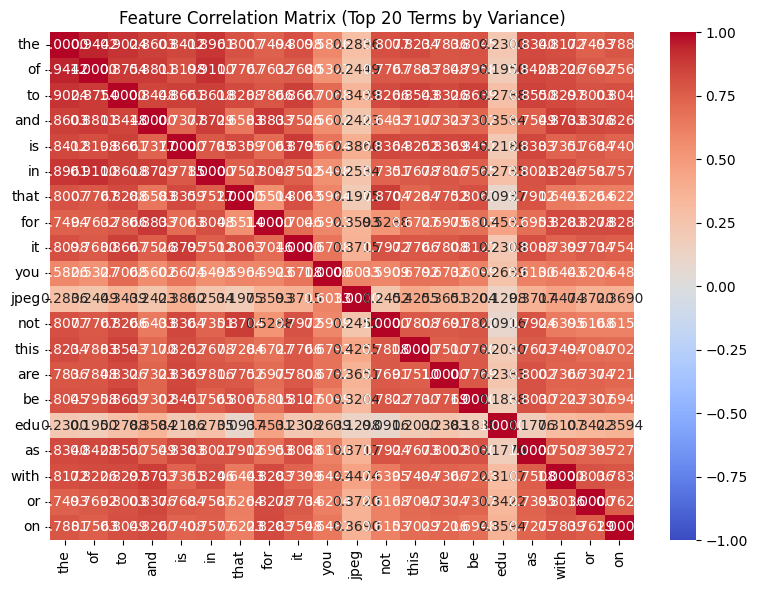
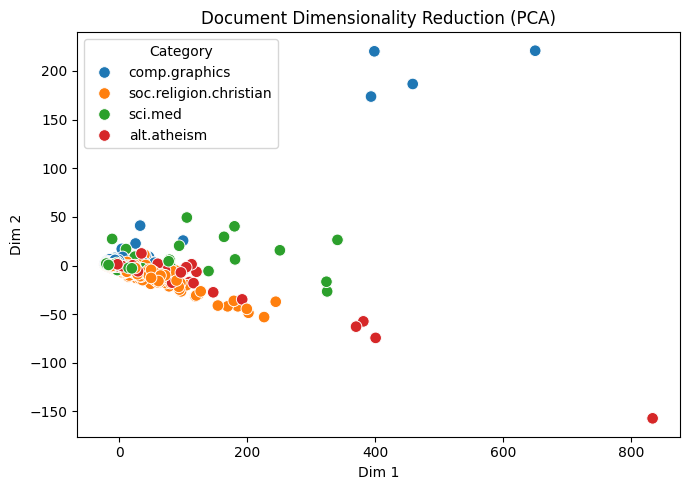

# DM2026 Lab 1 — Agentic Pipeline Report

## 1. Dataset and Objective

For this lab, I used the 20 Newsgroups dataset with four categories: `alt.atheism`, `comp.graphics`, `sci.med`, and `soc.religion.christian`, containing 2,257 documents in total. I wanted to see whether data mining methods could identify words that distinguish different discussion topics. I was also interested in whether documents from the same category would appear closer together after dimensionality reduction. Since the four categories had fairly similar numbers of documents and there were no missing values or duplicates, I decided to keep the entire dataset instead of sampling it.

## 2. Text Processing and Feature Selection

I first tokenized the documents (`tokenize_7`) and built a Document-Term Matrix with 35,788 terms (`build_dtm_9`). The matrix was 99.547% sparse, which was higher than I initially expected. Looking at the term frequencies (`term_freq_10`), I noticed that common words like `the` and `of` appeared much more often than topic-related words. Even `edu` appeared 4,675 times, probably because the original newsgroup messages included email information. I considered removing stopwords, but decided to keep the original DTM settings for this run so I could follow the pipeline consistently. After applying variance filtering with a threshold of 0.15 (`variance_filter_12`), only 709 terms remained out of 35,788. I was surprised that almost 98% of the vocabulary was removed. At this point, I started wondering whether removing so many low-variance words might also remove some useful topic-specific terms.

## 3. Correlation and Similarity Analysis

For Pearson and Spearman correlation, I chose `sci.med` because I thought medical discussions would have relatively clear keywords. However, the highest correlated word in both analyses was `pitt`, with Pearson r = 0.3795 (`pearson_filter_13`) and Spearman r = 0.3950 (`spearman_filter_14`). I expected words like `medicine` or `doctor` to rank higher, so this result was quite unexpected. My guess is that some words are related to the people or institutions posting the messages rather than the actual topics. I also tested cosine similarity between two `comp.graphics` documents and got 0.3532 (`cosine_sim_15`). Although they belong to the same category, their similarity was not particularly high. The feature correlation matrix (`feature_corr_16`) showed that `the` and `of` had a correlation of 0.9442. I think document length might explain part of this, since longer documents naturally contain more common words.

## 4. Dimensionality Reduction and Pattern Mining

I used PCA to reduce the documents to two dimensions (`reduce_dim_17`). The first two components explained 70.27% of the variance, but the visualization was not as clear as I expected. Most documents from the four categories were mixed together, and a few points were far away from the main group. I originally thought the categories might form four visible clusters, but PCA did not really show that. I suspect some of the variation came from document length rather than topic differences. For pattern mining, I used FP-Growth on `sci.med` with variance filtering and a minimum support count of 10. The tool generated 277,171 patterns, which was far more than I expected. However, some of the most frequent patterns were `[subject]` (594), `[lines]` (585), and `[organization, subject]` (582). Instead of finding many medical-related word combinations, I ended up finding patterns related to email formatting. This made me realize that producing more patterns does not necessarily mean finding more useful information.

## 5. Conclusion and Reflection

Overall, I think the most interesting part of this lab was seeing how much preprocessing affects the final results. At first, I mainly focused on getting each tool to run successfully, but after comparing the outputs, I noticed that similar problems kept appearing. Common words influenced the feature selection, possible email information appeared in the correlation results, and email-related patterns dominated the FP-Growth output. Looking back, I think keeping the original DTM without removing headers and stopwords was probably not the best choice for finding meaningful topics. If I were to redo the experiment, I would first clean the text and try TF-IDF instead of raw word counts. I would also like to compare the PCA visualization before and after preprocessing to see whether the four categories become easier to separate.
