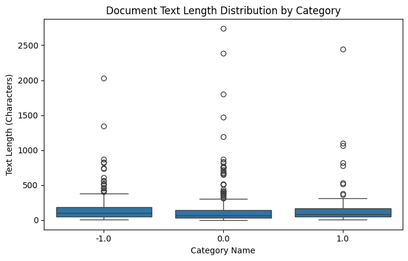
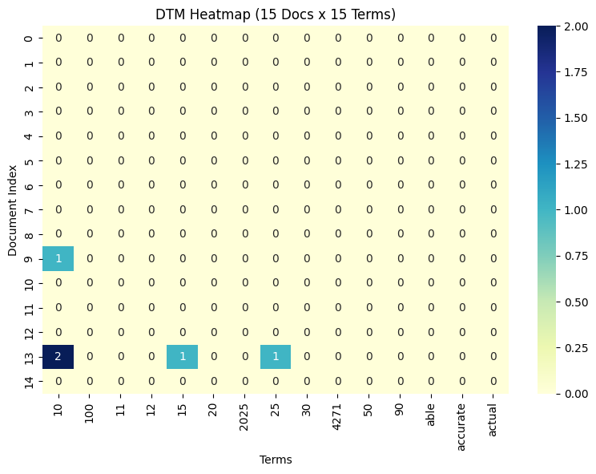
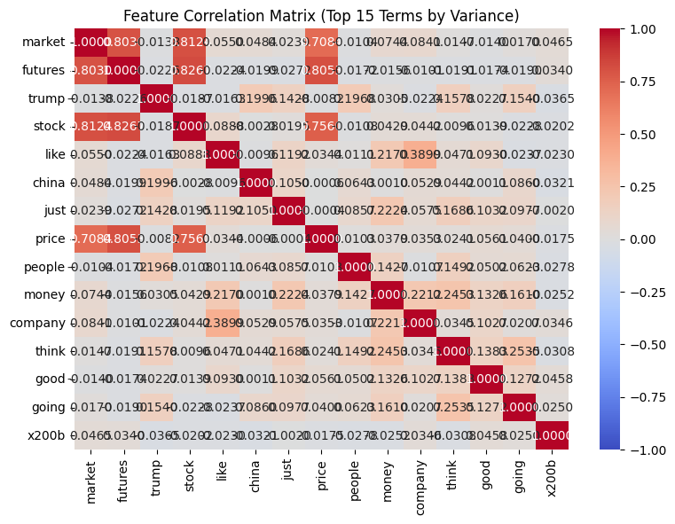
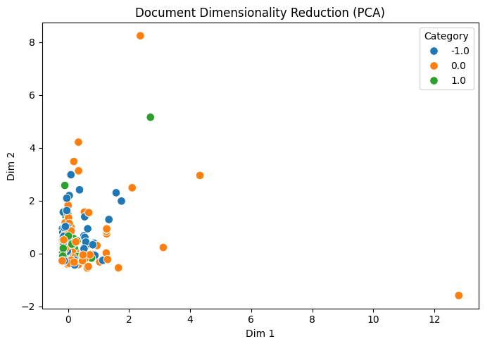

# DM2026 Lab 1 — Homework Report

## 1. Dataset and Data Quality

For the homework analysis, I loaded `newdataset/Reddit-stock-sentiment.csv` using the `text` and `label` columns (`load_dataset_1`). The dataset contains 847 Reddit posts or comments: 423 neutral (`0.0`), 315 negative (`-1.0`), and 109 positive (`1.0`). The class distribution is therefore imbalanced, especially for positive sentiment. The missing-value check found no missing or empty text entries (`check_missing_3`), but the duplicate check found 34 duplicated rows (`check_duplicates_4`). I used `drop=False`, so all 847 rows were retained. This preserves the original dataset but means repeated posts may influence term counts and patterns. Tokenization produced an average of 31.1523 tokens per document (`tokenize_5`). Text lengths were highly variable: the median was 78 characters, while the maximum was 2,737 (`describe_6`). Positive documents had the highest mean length at 163.27 characters, although the large standard deviations show that each class contains substantial variation.

## 2. Document Term Matrix and Feature Filtering

I built a unigram Document-Term Matrix with English stopwords removed, `min_df=5`, and `max_df=0.95` (`build_dtm_7`). The resulting matrix contained 847 documents and 444 terms, with 4,573 non-zero entries out of 376,068 cells. Its sparsity was therefore 98.784%. This remained high even after document-frequency filtering because the Reddit texts were short and each post used only a small subset of the vocabulary. The most frequent terms (`term_freq_8`) mixed finance-related language—`market` (111), `trump` (92), `china` (72), `stock` (51), and `tariffs` (39)—with conversational words such as `just` (95), `like` (83), and `think` (52). A variance threshold of 0.01 retained 249 terms and removed 195 (`variance_filter_10`). The DTM heatmap (`dtm_heatmap_9`) also illustrated the sparsity: most cells in the selected 15-document by 15-term slice were zero.

## 3. Sentiment Associations and Similarity

I compared Pearson and Spearman correlations against positive sentiment (`1.0`). Pearson identified `nice` (r = 0.1545), `technology` (r = 0.1514), `potential` (r = 0.1311), and `good` (r = 0.1093) as the strongest positive associations (`pearson_filter_11`). Spearman returned nearly the same leading terms, with `technology` (ρ = 0.1599), `nice` (ρ = 0.1545), `potential` (ρ = 0.1358), and `good` (ρ = 0.1142) (`spearman_filter_12`). Their agreement suggests that these associations are not dependent only on unusually large word counts, although all coefficients are modest and should not be treated as strong predictors. I also compared documents 0 and 4, which both have the negative label, but their cosine similarity was 0.0 (`cosine_sim_13`). This shows that sharing a sentiment label does not imply sharing vocabulary; negative sentiment can be expressed through completely different topics or wording.

## 4. Feature Relationships, Patterns, and PCA

The feature correlation heatmap (`feature_corr_14`) showed strong co-occurrence among market-related terms. The strongest pairs were `futures`–`stock` (0.8267), `market`–`stock` (0.8124), `futures`–`price` (0.8053), and `market`–`futures` (0.8030). These values may reflect a subset of posts that repeatedly discuss the same market concepts, and the 34 duplicated rows may strengthen some of these relationships. Label binarization produced three columns in the order `-1.0`, `0.0`, and `1.0`, with shape 847 × 3 (`binarize_15`). For positive posts, TF-IDF filtering followed by Top-K pattern mining returned 15 patterns (`mine_patterns_16`). The most frequent were `[just]` with support 15, `[good]` with support 12, `[doing]` with support 9, and `[like]` and `[going]` with support 8 each. Most were single-word patterns, so the result captured common positive-class vocabulary rather than rich multi-word relationships. PCA reduced the DTM to two dimensions (`reduce_dim_17`), but the components explained only 11.07% and 4.30% of the variance, or 15.37% in total. The scatter plot therefore provides only a limited two-dimensional representation, and the sentiment groups should not be expected to separate cleanly.

## 5. Conclusion and Reflection

The pipeline found interpretable finance vocabulary and a small group of words associated with positive sentiment, but it also exposed important limitations. The labels were imbalanced, duplicated rows were retained, documents with the same label could have no vocabulary overlap, and the first two PCA components preserved only 15.37% of the variance. The agreement between Pearson and Spearman was encouraging, but the low coefficients suggest that individual words alone do not determine sentiment. If I repeated the analysis, I would first remove duplicated rows, compare unigram and bigram features, and test TF-IDF-based representations for similarity and dimensionality reduction. I would also compare PCA with UMAP or t-SNE and evaluate whether the apparent visual separation is stable rather than relying on a single projection.
